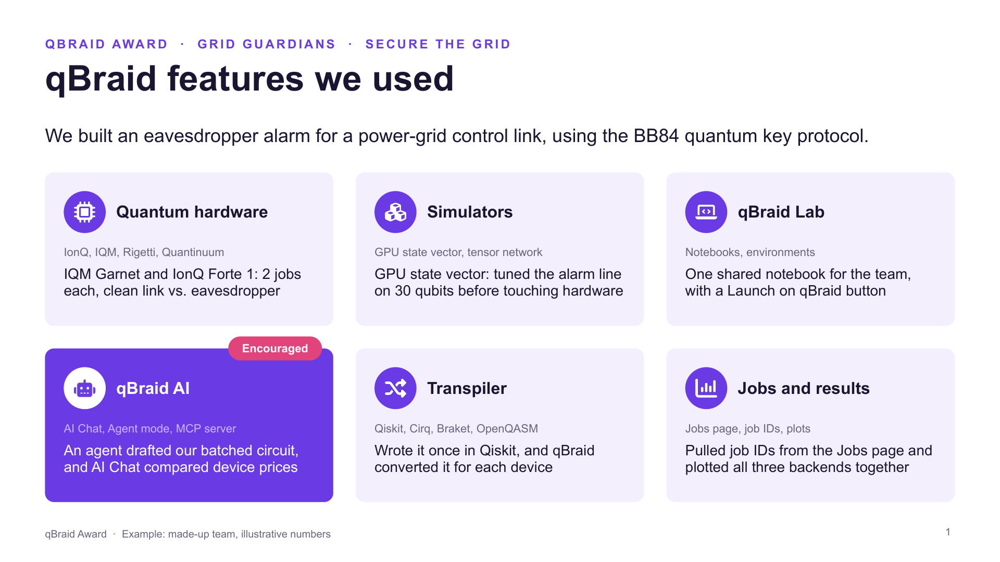
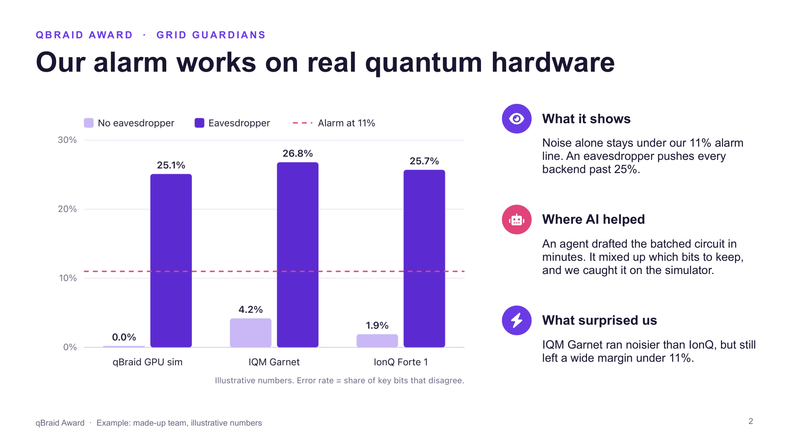
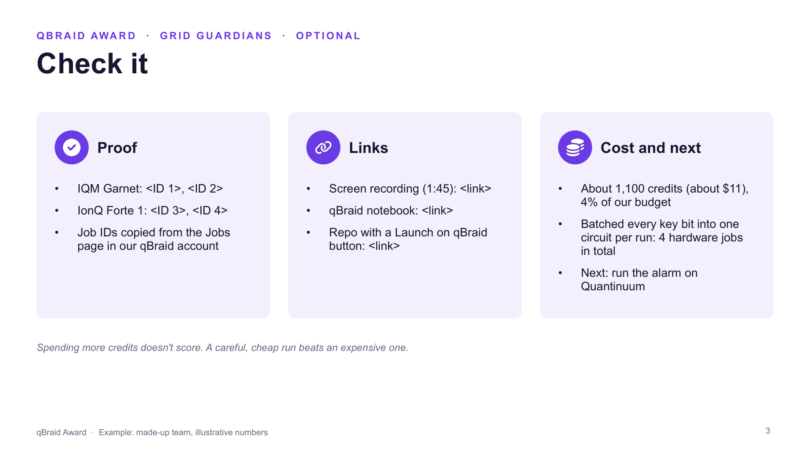

# qBraid Award: most creative use of qBraid

**Optional and open to every team, in every track.** You win it with the project you're already building, and entering takes about 30 minutes at the end.

| | |
|---|---|
| **What you send** | 2 or 3 slides from the template in this folder, a 3 to 5 minute screen recording, and a link to your [qBraid artifact](#make-it-visual-in-one-line) if you made a visual |
| **Where** | [The entry form](https://docs.google.com/forms/d/e/1FAIpQLSeeom5YX0jADpt1a09Xox9EUQYPtJYoaggeVy-1iX4VT3yY9g/viewform) (also pinned in Discord) |
| **When** | By **Sunday 9:00 AM**, with your final project materials |
| **Prize** | $200 in gift cards split across the winning team, plus qBraid credits for each member. Announced at the closing ceremony |
| **Judged on** | Did it run on qBraid, and how creatively did you use it? |

> **Use your credits.** They're there to be used, not to sit in your wallet. Run on real hardware, launch a GPU, try qBraid AI, and explore everything in the [qBraid docs](https://docs.qbraid.com). The one rule: every run should do something for your project. Benchmarking a device just to fill a table doesn't count.

> **Try a GPU.** Once your problem grows past a few dozen qubits or a big optimization, a laptop-sized simulator can't keep up. Launch an on-demand GPU instance, or send circuits to qBraid's GPU simulators ([how](#ideas)). A GPU run that moves your project forward counts in your favor.

## Enter in 4 steps (about 30 minutes)

1. **Use qBraid in your project.** You probably already are: if your notebook runs in qBraid Lab and sends a job to a qBraid device or simulator, you qualify. Want to stand out? [Make it visual](#make-it-visual-in-one-line) (about 5 minutes), or take your problem to a GPU.
2. **Fill in the slides (10 minutes).** The template is in this folder: [`qbraid-award-template.pptx`](./qbraid-award-template.pptx).
   - **Get it:** in qBraid Lab, right-click the file and choose Download.
   - **Open it:** PowerPoint, Keynote or Google Slides all work. For Google Slides, upload it to Drive, then open it with Google Slides.
   - **Fill it in:** every slide tells you what to write. The speaker notes tell you what to say in your video.
3. **Record your screen (10 minutes).** Walk through your slides, then show qBraid running. Use the [script below](#the-video-script).
4. **Fill in the [entry form](https://docs.google.com/forms/d/e/1FAIpQLSeeom5YX0jADpt1a09Xox9EUQYPtJYoaggeVy-1iX4VT3yY9g/viewform) (2 minutes).** It's also pinned in Discord. One person enters for the whole team:
   - team name
   - challenge track
   - every team member's email, one per line: the email each person uses on qBraid, so the prize and credits reach everyone
   - slides link
   - video link
   - qBraid artifact link, if you [published a visual](#make-it-visual-in-one-line)
   - your own email, so the form can send you a copy of the entry with a link to edit it

   Set every link to "anyone with the link can view". You can edit your entry until the deadline.

## Make it visual in one line

Judges love a visual, and this gets you one fast. Run this in a notebook cell after you have results:

```python
import sys; sys.path.append("../4-qbraid-award")
from make_visual import make_visual

make_visual({"Simulator": sim_counts, "IonQ": hw_counts}, title="Our results")   # or just one counts dict
```

Use the names your notebook already has: plant scheduling `make_visual({"Simulator": sim_counts, "IonQ": counts})`; sensor placement `make_visual({"IonQ": counts})`; BB84 and Grover `make_visual({"Simulator": counts, "IonQ": hw_counts})`; QRNG `make_visual({"IonQ": hw_counts})`.

1. **The cell writes `visual.html`,** an animated bar chart, in the same folder as your notebook.
2. **Open it next to your notebook** in qBraid Lab's Agent Canvas panel. Run this from a Lab terminal in that folder:

   ```bash
   qbraid-canvas visual.html --title "Our results"
   ```

3. **Publish it as a qBraid artifact,** so judges can open it from a link. From the same terminal:

   ```bash
   qbraid artifacts publish visual.html --title "Our results" --visibility public
   ```

   It prints a link anyone can open. Put that link in the entry form and on your slides. If `qbraid artifacts` isn't available in your terminal, ask a qBraid mentor.
4. **Make it yours.** Ask your coding agent to restyle it, add controls, animate your algorithm step by step, or turn it into a game. To publish the new version to the same link, run `qbraid artifacts list` for its ID, then `qbraid artifacts update <ID> --file visual.html`.

For inspiration, see [Quantum Runner](https://account.qbraid.com/explore/projects/q-ready-quantum-runner-2gkzz6) on qBraid's Explore page. It's a side-scroller where a real quantum measurement decides where the gaps go.

## The slides

Keep 2 or 3 slides. Each one has instructions on it: replace the bracketed text, and delete what you don't use.

| Slide | What goes on it |
|---|---|
| 1. **qBraid features we used** | One tile for each feature you used, with a line on how. Delete the rest |
| 2. **Our best qBraid moment** | One visual (a chart, your interactive view, or a frame from your game), what it shows, and where AI helped |
| 3. **Check it** (optional) | Job IDs, links and what your credits went to |

Here's a [finished example](./qbraid-award-example.pptx) ([PDF](./qbraid-award-example.pdf)). The team is made up and the numbers are illustrative.



<details>
<summary>Example slides 2 and 3</summary>





</details>

## The video script

Record your screen with someone on the team talking, 3 to 5 minutes. One take is fine, and it doesn't need editing. Be thorough: this video is how judges see your work, so show it off, tied to your challenge.

| Time | Show | Cover |
|---|---|---|
| 0:00 to 0:45 | Slide 1 | **The problem.** Your track's challenge in plain words, who it matters to (a grid operator, a utility, a security team) and what you built to tackle it. |
| 0:45 to 3:15 | **qBraid doing real work, live:** your notebook or tool in qBraid Lab, a job on the Jobs page, your visual or artifact, a GPU run, the agent building something | **How you used qBraid for this problem, specifically.** For each feature: what you did, why it helped your challenge, and what happened. For example: "We sent our 6-substation circuit to IonQ Forte to see how hardware noise changes the placement. Here's the job, and here's how the answer shifted." |
| 3:15 to 4:30 | Slide 3, or your visual running live | **What you found.** The result in plain words, what surprised you, and how AI helped (and where you checked it). |
| Last 30 seconds | Slide 3, or just your face | **What's next.** What you'd try with more time. |

**One rule:** we have to *see* it run on qBraid.

**Not enough on its own:** "We submitted a job using qBraid." Tell us what that job did for your challenge and what you learned from it.

**How to record and share:**
- **Mac:** Cmd+Shift+5
- **Windows:** the Snipping Tool's record option
- **Share it:** upload it unlisted to YouTube, to Loom, or to Google Drive with "anyone with the link can view"

## Ideas

Your credits are there to be used, so try things. Pick what moves your track's problem forward, and say in your video why you used it.

- **Make it visual (we'd love to see this).** An interactive view of your grid, an animation of QAOA converging, a live dashboard, or a game. Start from [the one-liner above](#make-it-visual-in-one-line).
- **Share it on Explore.** Put your project in a GitHub repo and submit it from qBraid's Explore page, so anyone can launch it in qBraid Lab with one click.
- **Real hardware, across devices.** Run your track's problem on IonQ, Quantinuum or IQM, and compare it with the simulator. A second device should answer a question your project has, such as how hardware noise changes your answer. Prices and live status are in the [device catalog](https://account.qbraid.com/devices).
- **Run GPUs.** Take your problem past what fits on a laptop.
  - **On-demand GPU instance:** launch one from the **On-Demand** tab of your [qBraid dashboard](https://account.qbraid.com/dashboard) ([GPUs in qBraid Lab](https://docs.qbraid.com/v2/lab/user-guide/gpus)).
  - **GPU simulators:** send circuits to `qbraid:qbraid:sim:gpu-sv` (exact, up to 35 qubits) or `qbraid:qbraid:sim:gpu-tn` (tensor network, up to 500 qubits) ([GPU simulators](https://docs.qbraid.com/v2/sdk/user-guide/providers/gpu-simulators)).
- **qBraid AI (encouraged).** Chat and an agent do different jobs:
  - **Chat answers questions.** Ask [AI Chat](https://account.qbraid.com/chat) in your qBraid account to compare devices, explain a result or decode an error.
  - **An agent does the work, inside qBraid Lab.** Open the Lab Launcher and click the **Claude** or **Codex** icon. The agent runs in your Lab, so it can read your notebooks, write and run code, and build your visual. Use it when you want something built or changed, not just explained.
  - Connect your own AI tool to qBraid's [MCP server](https://docs.qbraid.com/v2/ai/integrations/mcp-server) at `https://mcp.qbraid.com/mcp`.
- **The rest of the [qBraid docs](https://docs.qbraid.com):**
  - the [Circuit Composer](https://docs.qbraid.com/v2/account/composer)
  - [Quantum Jobs](https://docs.qbraid.com/v2/lab/user-guide/quantum-jobs) in Lab
  - the [transpiler](https://docs.qbraid.com/v2/sdk/user-guide/transpiler), which runs one circuit on any device

**Have a reason for each run.** Credits spent on your project count in your favor. Benchmarking a device just to run a benchmark doesn't.

**These don't count on their own:**
- signing up
- running local code in a notebook
- one "hello world" job unconnected to your project
- benchmarks that don't connect to your project

## How we judge

qBraid staff watch every video after the deadline, with your slides open. This is separate from track judging.

1. **Did it clearly run on qBraid?** If not, the entry is out.
2. **How creatively did you use it?** Scored 1 to 5. These all push the score up:
   - a creative visualization (an interactive view, an animation or a game built on your results)
   - several qBraid features, each used for a good reason
   - runs across devices, or a GPU run, that move your problem forward
   - a clever use of AI

We re-watch the top two and pick the winner.

**Use your credits.** Hardware, GPUs and qBraid AI all count when they serve your project. Benchmarks for their own sake don't.

## Quick answers

**Do we have to change our project?** No. Show how qBraid fits into what you're already building.

**Should we save our credits?** No. Use them on hardware, GPUs and qBraid AI. Just make sure each run does something for your project.

**We only used simulators. Can we still win?** Yes. Hardware isn't required.

**Does everyone on the team need to enter?** No. One person enters for the team, and lists every member's qBraid email so the prize and credits reach each of you.

**What's a qBraid artifact?** A page you publish from qBraid Lab with `qbraid artifacts publish`, such as your `visual.html`. It gives judges a link they can open without running your code. See [Make it visual](#make-it-visual-in-one-line).

**Can we use AI?** Yes, please. Say what it did and where you stepped in.

**How do I know my job ran on qBraid?** It's on the Jobs page in your qBraid account, with its job ID.

Questions? Ask anyone from qBraid at the event or in Discord.
