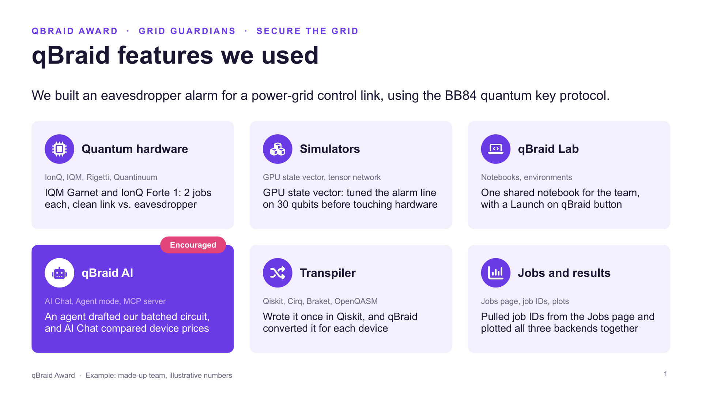
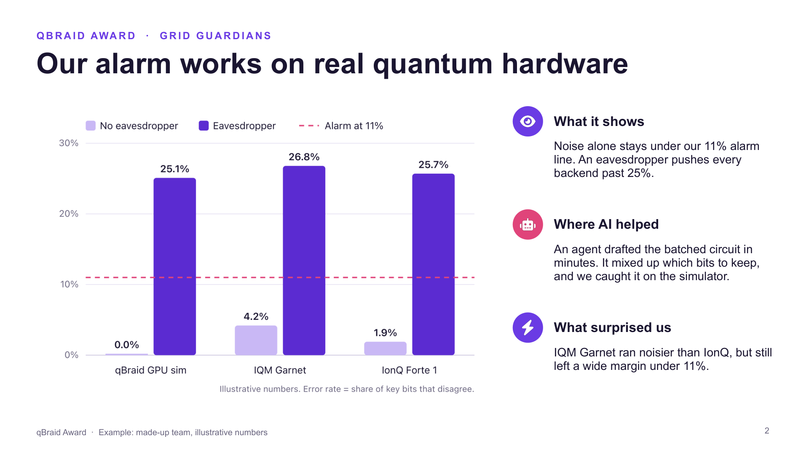
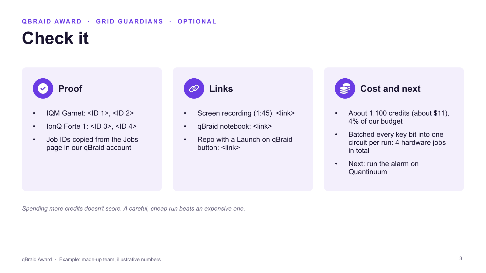

# qBraid Award: most creative use of qBraid

**Open to every team, in every track. Optional.**

The qBraid Award goes to the team that makes the most creative use of [qBraid](https://account.qbraid.com) this weekend. It isn't a separate challenge: you win it with the project you're already building for your track. To enter, send us **2 or 3 slides** and a **3 to 5 minute video** that walks through them with qBraid running on screen.

| | |
|---|---|
| **What you submit** | 2 or 3 slides from [our template](./qbraid-award-template.pptx), plus a 3 to 5 minute video walking through them with qBraid running on screen |
| **Where** | The entry form pinned in Discord: team name, slides link, video link, and one team member's qBraid email |
| **When** | By **Sunday 9:00 AM**, with your final project materials |
| **Prize** | $200 in gift cards split across the winning team, plus qBraid credits for each member. Announced at the closing ceremony |
| **Judged on** | Did it run on qBraid, and how creatively did you use it? |

## How to enter

1. **Use qBraid in your project.** You don't need to change what you're building.
2. **Make 2 or 3 slides** from the [template](./qbraid-award-template.pptx). It opens in PowerPoint, Keynote or Google Slides.
3. **Record a 3 to 5 minute video** walking through your slides with qBraid running on screen.
4. **Fill in the entry form** before Sunday 9:00 AM. You can edit it until the deadline.

## The slides

1. **qBraid features we used.** Keep a tile for each feature you used, add a line on how, and delete the rest.
2. **Our best qBraid moment.** One chart or screenshot, what it shows, and where AI helped.
3. **Check it (optional).** Job IDs, links and cost.

Here's a [finished example](./qbraid-award-example.pptx) ([PDF](./qbraid-award-example.pdf)). The team is made up and the numbers are illustrative.

Example slides 2 and 3

## The video

A screen recording, with someone on your team talking. It doesn't need editing.

| Time | Show |
|---|---|
| 0:00 to 0:30 | Your team, your track, and what you built |
| 0:30 to 3:00 | **qBraid doing the work, on screen:** your notebook running in qBraid Lab, a job going to a simulator or quantum hardware, results coming back on the Jobs page |
| 3:00 to 4:30 | Your best result, plus where AI helped and where you stepped in |
| Last 30 seconds | What you'd try next |

**One rule:** we have to *see* it run on qBraid.

**Recording and sharing:**
- **Mac:** Cmd+Shift+5.
- **Windows:** the Snipping Tool's record option.
- **Sharing:** upload it unlisted to YouTube, to Loom, or to Google Drive with "anyone with the link can view".

## Ideas

- **Real hardware.** Run your track's problem on IonQ or Quantinuum, and compare it with the simulator.
- **qBraid AI (encouraged).**
  - Ask [AI Chat](https://docs.qbraid.com/v2/ai/user-guide/overview) to compare devices or explain a result.
  - Run a coding agent in Agent mode.
  - Connect your own AI tool to qBraid's MCP server at `https://mcp.qbraid.com/mcp`.
- **Compare devices.** Run the same circuit on trapped-ion and superconducting hardware, and explain the difference.
- **Bigger problems.** Use qBraid's GPU simulators to go past what fits on a laptop.
- **Write once, run anywhere.** Write in one framework and run on a device that expects another. The [qBraid transpiler](https://docs.qbraid.com/sdk/user-guide/transpiler) does the conversion.

**Doesn't count on its own:** signing up, running local code in a notebook, or one "hello world" job that's unconnected to your project.

## How we judge

qBraid staff watch every video after the deadline, with your slides open, separately from track judging.

1. **Did it clearly run on qBraid?** If not, the entry is out.
2. **How creatively did you use it?** Scored 1 to 5.

We re-watch the top two and pick the winner. Spending more credits doesn't help: a careful, cheap hardware run beats an expensive one.

Questions? Ask anyone from qBraid at the event or in Discord.
